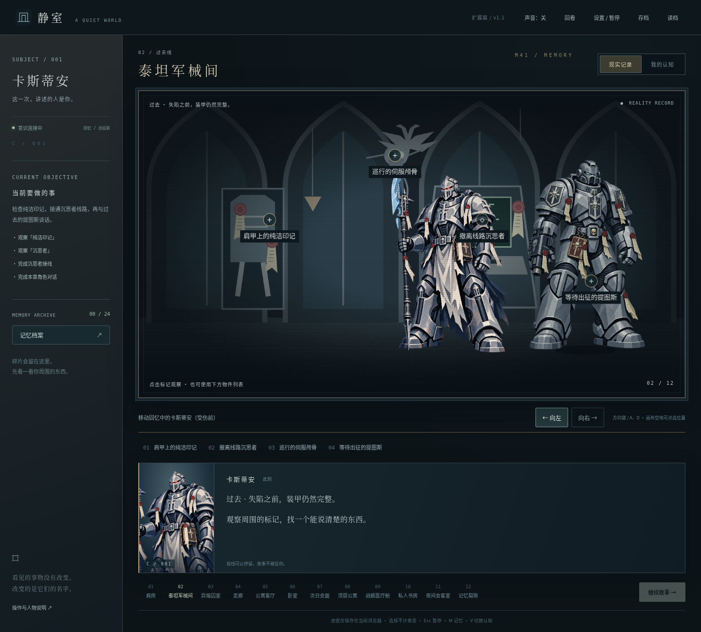

# 静室 · A Quiet World — 扩展篇 v1.1

卡斯蒂安视角的2D点击式心理恐怖游戏，Phaser 3 + TypeScript + Vite。基于用户提供的《Warhammer 40k Fanfic Setup.pdf》，现代与过去双线交错；抽象无脸人物，过去阿斯塔特全封闭头盔。

## 当前发布状态

扩展版已上传，GitHub构建和Release附件发布成功。Pages首次创建被仓库工作流令牌拒绝：`403 Resource not accessible by integration`。仓库所有者需在 [Pages设置](https://github.com/JackRobertFoxy/whfanficgame/settings/pages) 将Source选为GitHub Actions；启用后可继续自动部署。当前不能将预期站点当作已上线。



[电脑解密界面](screenshots/computer.png) · [安卓手机界面](screenshots/android-phone.png)

## 下载与游玩

- [GitHub仓库内完整网页包](downloads/quiet-world-web-v1.1.zip)：进入文件页后选择下载原始文件。
- [Release页面](https://github.com/JackRobertFoxy/whfanficgame/releases/tag/web-v1.1)：自动工作流成功后提供同一网页包。
- 预期Pages站点：`https://jackrobertfoxy.github.io/whfanficgame/`，**以部署状态为准**。
- [自动部署状态分支](https://github.com/JackRobertFoxy/whfanficgame/tree/codex-pages-status)：工作流完成后生成，含实际结果及错误。

静态网页包供HTTP/HTTPS托管，不能只双击HTML运行。线上电脑与安卓浏览器使用同一网址；支持首次完整缓存后的离线游玩和添加到桌面，不是原生APK。源码与网页包均推送到本仓库，上传本身不等于Pages已成功上线。

## 本版内容

十二章：病房 → 泰坦军械间 → 异端囚室 → 走廊 → 公寓客厅 → 卧室 → 医生会面 → 顶层公寓 → 战舰医疗舱 → 私人书房 → 夜间会客室 → 记忆裂隙。

24枚双认知碎片，54个关注点，三种结尾与条件后日谈。萨拉马斯在过去与现代有不同立绘与连续剧情；书房档案和夜间对话具体解释调查、失踪与控制，不要求玩家靠谜语猜人物关系。

四种小游戏：沉思者线路、救援记录排序、电脑邮件解密、手机联系人核验。现代设备由其他角色代操作，玩家决定查什么、输入什么；不假定卡斯蒂安有手。方向键／A、D或触控按钮移动陪同人物；只有受伤前的军械间回忆能移动完整身体的卡斯蒂安。

物件有现实记录／主观认知；能回看最近400条叙事。自动／手动存档、JSON导入导出、v1／v2迁移、小游戏部分进度保存；设备输入可用屏幕数字键，排序不用拖拽。手机大按钮与大字模式保持可用。

## 运行与构建

Node 22.12+ 或24，npm。

```sh
npm ci
npm run dev
npm test
npm run build
npm run package
```

构建同时生成完整离线资源清单与service worker。打包输出 `release/quiet-world-web-v1.1.zip` 并同步到仓库的 `downloads/`。GitHub Actions会先发布下载附件，再尝试自动启用和部署Pages，即使Pages权限失败，下载包仍独立提供。

```sh
npm run preview -- --port 4173
# 另一终端；生产根目录验证
DEMO_URL=http://127.0.0.1:4173/ npm run test:e2e
```

浏览器测试默认使用 `/usr/bin/chromium` 与本机 `/whfanficgame/` 子路径，可用 `CHROMIUM_PATH`、`DEMO_URL` 改写。`E2E_TARGET=desktop`／`android` 可分别运行。触控模拟不是安卓真机验收。

## 文档与边界

- [本次扩展设计、改编依据与设备机制](docs/EXPANSION_V1_1.md)
- [当前验证与发布结果](docs/VALIDATION.md)
- [部署说明](docs/DEPLOYMENT.md)
- [v1.0设计基线](docs/GDD.md) · [原目录说明](docs/PROJECT_STRUCTURE.md)
- [角色美术说明](public/art/ART_NOTES.md)

现代主角失去四肢，转移始终依赖协助。游戏不包含战斗练级、云账号、配音或原生APK。角色移动是纸片式动画，不是骨骼动画。原PDF不打包、不外传，运行时没有外部图片、字体、AI或真实短信服务。
