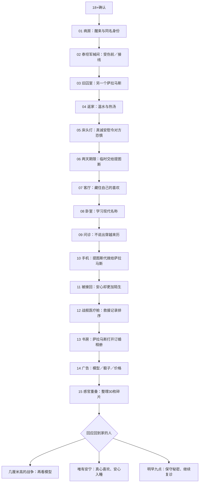

# v1.2 场景流程

每章找齐本地关键碎片、完成必要小游戏，再完成角色谈话即可前进。已到访场景可回看；此前选项保留已选回应。军械间移动受伤前的卡斯蒂安；现代移动陪同者，设备由他人代操作。记忆裂隙是短暂主观重叠，实际位置仍在公寓沙发。

结尾整理的三个来源为旧世界亲历（witness）、学会的现代常识（ordinary）、电视商品（model）。分类不改变身体，不揭露来历，不消除对萨拉马斯的真心依恋。剧情依据见 [v1.2改编说明](NARRATIVE_V1_2.md)。
