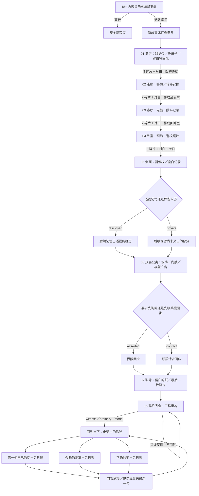

> 当前版本已升级为扩展篇v1.1（十二章、24碎片、存档v3）。本文件保留v1.0基线；当前变更见 [扩展设计](EXPANSION_V1_1.md)。

# 完整篇场景流程 · v1.0

每章先观察关键物件获得碎片，再完成角色对白；前六章达到条件后才能进入新章。裂隙须先得到第十五枚碎片，再确认重构。已到访章可回看；回看既有选择只播放已选回应，不改写此前决定。

早期陪伴／界限、是否透露记忆、是否提出要求会通过条件对白与后日谈被引用。没有善恶评分，不把暂时保留来历设为坏结局。

场景转移依赖协助或记忆转场，裂隙是主观认知空间。原作时间压缩与新增桥段见 GDD。
